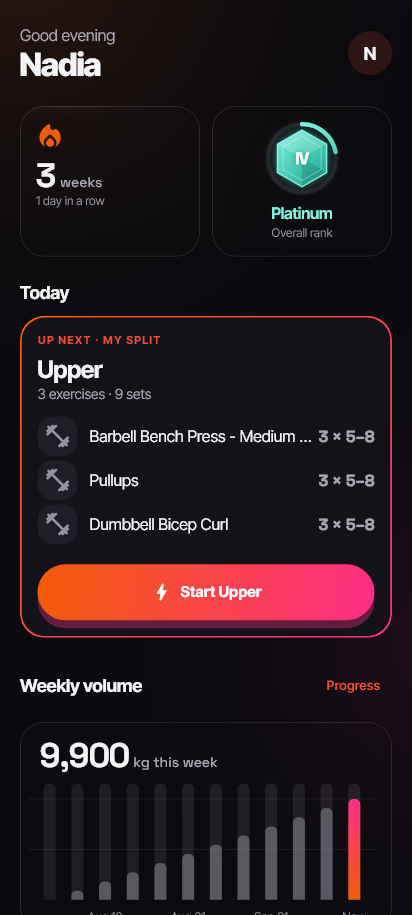
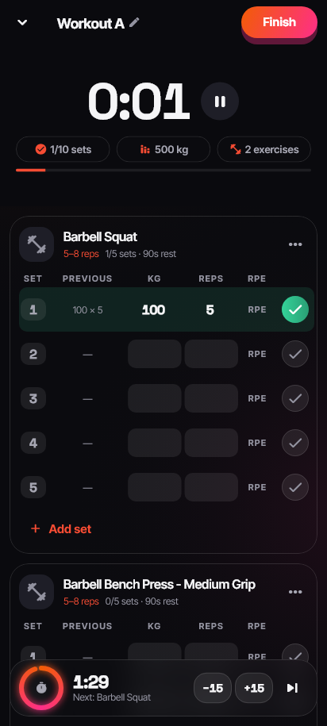
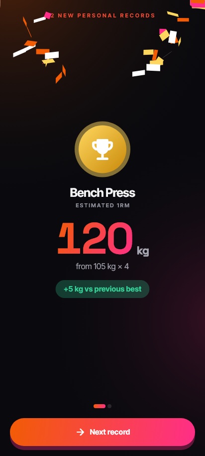
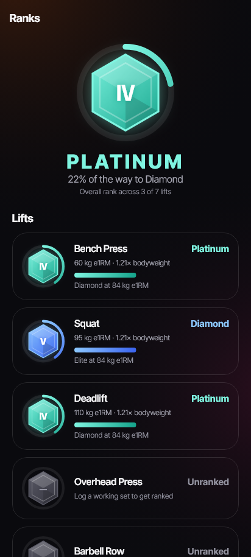
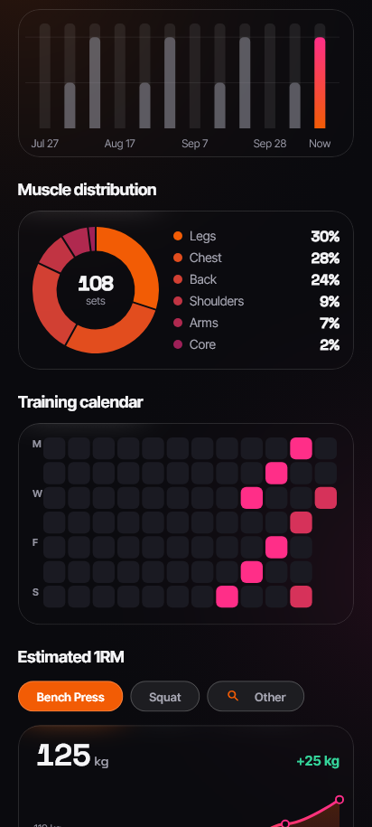
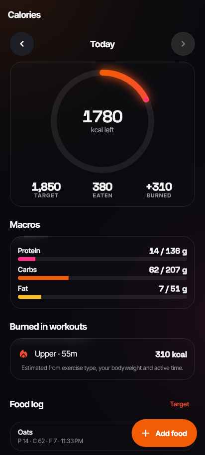
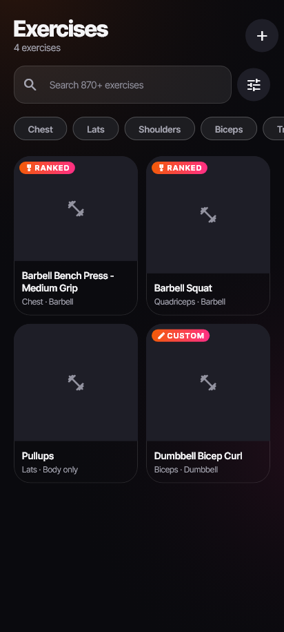
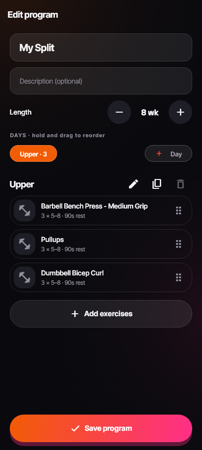

# IronRank

A gym tracker for Android and iOS. You log workouts fast, it detects personal records automatically, ranks your strength from Bronze to Legend for your bodyweight, and sets a daily calorie target.

| | | | |
|:-:|:-:|:-:|:-:|
|  |  |  |  |
| Dashboard | Logging with rest timer | New PR | Strength ranks |
|  |  |  |  |
| Progress & heatmap | Calories | Exercise library | Program builder |

> The screenshots are rendered by the widget tests. In the test environment exercise photos show as placeholders and shadows are unblurred.

## Features

- **Workout logging.**
  - Big session timer, with previous-session values shown as ghost text.
  - Set types: warm-up, working, drop set and failure. RPE per set.
  - Add or swap exercises mid-session.
  - The rest timer starts automatically, with ±15 s and Skip, and haptic, sound and notification alerts even when the app is in the background.
  - **Offline-safe.** Every change is saved on the phone, and workouts finished offline sync later.
- **PR detection.** The server checks every working set against your history for the heaviest weight, estimated 1RM (Epley), best set volume and most reps at a weight. New PRs get a full-screen celebration.
- **Strength ranks.**
  - Seven tiers for bench, squat, deadlift, overhead press, row, pull-up and dips, based on e1RM ÷ bodyweight with standards for men and women.
  - Also a rank per muscle group and an overall rank, with progress to the next tier and a level-up animation.
- **Programs.** Push/Pull/Legs, Upper/Lower, Full Body 3x and 5x5 templates, plus a drag-and-drop program builder. The active program lines up each day's workout.
- **Exercise library.** 876 exercises with photos from [free-exercise-db](https://github.com/yuhonas/free-exercise-db), searchable and filterable, plus your own custom exercises.
- **Progress.**
  - e1RM trends, bodyweight, weekly volume, sessions per week and muscle distribution.
  - A training calendar heatmap, and day and week streaks.
- **Calories.**
  - A TDEE target (Mifflin-St Jeor × activity level) for cutting, maintaining or bulking, plus macro targets.
  - Quick food logging.
  - Estimated calories burned in workouts (MET × bodyweight × active time).
- **Design.**
  - Dark-first with a light mode, glass cards and one orange→magenta accent.
  - Spring-physics buttons, staggered list entrances, charts that animate in, Hero transitions and shimmer loaders.
  - Every animation timing and curve is defined in [`motion.dart`](mobile/lib/core/theme/motion.dart).

## Tech stack

| Layer | Stack |
|---|---|
| Backend | Node.js 20+, Express 5 (ES modules), MongoDB + Mongoose, zod, JWT access and refresh tokens with rotation, Jest + supertest |
| Mobile | Flutter 3.47 / Dart 3.13, Riverpod 3, go_router, dio, Hive CE, fl_chart, flutter_animate, Lottie, flutter_local_notifications |

```
backend/   Express API (src/{config,models,controllers,routes,middleware,services,utils,seed})
mobile/    Flutter app (lib/core + lib/features/<feature>/{data,application,presentation})
docs/      API.md · SETUP.md · DECISIONS.md · screenshots
docker-compose.yml   MongoDB for local development
```

## Quick start

You need **Node.js 20+**, the **Flutter SDK (3.47+)** with an Android emulator or iOS simulator, and either **Docker** or a **MongoDB Atlas** database. See [docs/SETUP.md](docs/SETUP.md) for details and troubleshooting.

### 1. Start MongoDB

```bash
docker compose up -d          # MongoDB at mongodb://localhost:27017
```

If you don't use Docker, create a free cluster on [MongoDB Atlas](https://www.mongodb.com/atlas) and copy its connection string.

### 2. Run the API

```bash
cd backend
npm install
# backend/.env already exists with generated JWT secrets. Set MONGO_URI in it, for example:
#   MONGO_URI=mongodb://localhost:27017/ironrank
npm run seed        # downloads ~876 exercises + creates the 4 program templates
npm run dev         # API on http://localhost:4000 (health check: /health)
```

To try it **without any database**, run `npm run dev:memory`. It starts a throwaway in-memory MongoDB and seeds it automatically. All data is lost when it stops.

### 3. Run the app

```bash
cd mobile
flutter pub get
flutter run
```

By default the app talks to the **deployed API at `https://irontank.onrender.com/api/v1`**, so `flutter run` works without running the backend locally. The address is set in [`mobile/assets/config/app_config.json`](mobile/assets/config/app_config.json).

> The API runs on Render's free tier, which sleeps when idle. The first request after a quiet period can take up to a minute while it wakes up, so the app's timeouts allow for that.

To use a **local** backend instead, pass its address when you run the app (or edit the config file):

| Where the app runs | Local `API_BASE_URL` |
|---|---|
| Android emulator | `http://10.0.2.2:4000/api/v1` |
| iOS simulator | `http://localhost:4000/api/v1` |
| Physical phone on the same Wi-Fi | `http://<your-computer's-LAN-IP>:4000/api/v1` |

```bash
flutter run --dart-define=API_BASE_URL=http://10.0.2.2:4000/api/v1
```

## Tests

```bash
cd backend && npm test        # Jest + supertest, in-memory MongoDB (no setup needed)
cd mobile  && flutter analyze && flutter test
```

- **Backend:** auth (rotation and reuse detection), exercises, programs, workouts, PR detection, ranks, stats, calories and TDEE.
- **App:** the workout controller (offline queue, restore after restart), every screen at phone size and at 160% text size, WCAG contrast of the palette, and auth redirects.
- **Screenshots:** `flutter test --dart-define=GOLDENS=true --update-goldens` regenerates the snapshots in `mobile/test/screens/goldens`.
- **Live contract test:** drives the app's real networking stack against a running API:
  ```bash
  cd backend && PORT=4100 npm run dev:memory
  cd mobile  && flutter test test/contract --dart-define=API_URL=http://localhost:4100/api/v1
  ```

## Documentation

- [docs/API.md](docs/API.md): every endpoint, with request and response shapes and error codes.
- [docs/SETUP.md](docs/SETUP.md): detailed setup, device networking, notifications and troubleshooting.
- [docs/DECISIONS.md](docs/DECISIONS.md): design decisions and where the brief was interpreted.

## Credits

- The exercise data and photos come from [free-exercise-db](https://github.com/yuhonas/free-exercise-db) (public domain).
- The fonts are Inter Tight and Space Grotesk (SIL Open Font License) and are bundled in the app.
- Calorie and strength figures are estimates and are not medical advice.
